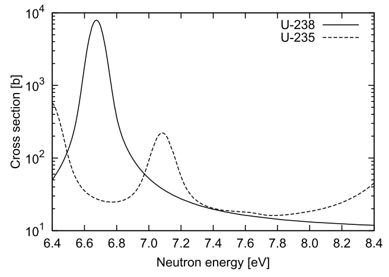

# Study Notes for Resonance Theory

## Abstract

To make clear of how to start the new research subject, resonance theory is studied thoroughly based on the text on our lab, "Handbook of Nuclear Engineering", and the materials from Nagoya Univ.

## 1. The purpose of "Resonance Theory"

General speaking, the purpose of we carry out the reactor physical calculation is predicting the nuclear reactor physical parameters through solving the transport equation(s).

The continuous energy transport equation is difficult to solve, and multi-group treatment (discretization) helps us solve the transport equation. We knew that some nuclides have very complex shape of cross-section in the energy range between 1eV to 100keV. Generally, tens of thousands to hundreds of thousands ($10^4$ to $10^5$) groups are needed to represent the continuous cross-section information.

However, it is impossible to solve the transport equation with so many groups even the geometry is simple. Therefore, techniques of reducing the number of groups is developed to make the calculation possible with the current computer. Even though using $10^3$ energy points, the characteristic (correlations between cross-section and energy) of cross-section can not be accurately represented.

**Resonance theory/calculation is the techniques that reducing the amount of energy points (groups) without compromising the calculation accuracy.** Various methods/techniques have been developed since 1940s.

## 2. Narrow Resonance (NR) approximation

As in the case of many mathematical physics problems, the solution process starts with the simplest model. In the beginning, people focus on the **Infinite homogeneous medium** and consider how to solve the multi-group transport equation in this simplest model.

Infinite homogeneous medium has two key features based on my knowledge

-   There is no neutron leakage.

-   There is no need to consider boundary condition.

Besides, the correlations with neutron angular $\vec{\Omega}$ and **space $\vec{r}$** are omitted at here. So that the neutron transport equations can be expressed as

$$
\Sigma_t(E)\phi(E)=\int_E^\infty \Sigma_s(E'\rightarrow E)\phi(E')\, dE' + Q(E),
\tag{1}
$$

in which $Q(E)$ is fission source. The format of this equation is different from what we commonly see since there is no neutron leakage term.

Generally, the energy range that must be considered in resonance calculation is 1eV $\sim$ 10keV, and the fission neutron energy is larger than $10^6$. So that the Eq. [(1)](#eq-1) can be further simplified as

$$
\Sigma_t(E)\phi(E)=\int_E^\infty \Sigma_s(E'\rightarrow E)\phi(E')\, dE'
\tag{2}
$$

for the resonance calculation since the resonance behavior of fission neutron is not significant in such energy range. Please keep in mind that the in-elastic scattering and $(n,2n)$ reactions are ignored too since the energy of these two reactions belongs to high energy range which is different from the resonance range.

The right hand side of Eq.[(2)](#eq-2) must be integrated to solve the equation. However, the integrating is impossible after realizing the shape of cross-section in resonance range. To solve the right-hand side of Eq. [(2)](#eq-2), the following assumptions are induced:

-   the scattering cross-section must be met the following equation,

    

    $$
    \Sigma_s(E' \rightarrow E) = \frac{\Sigma_{pot}}{(1-\alpha)E'} \approx \frac{C\Sigma_t}{E'},
    \tag{3}
    $$

-   the neutron flux $\phi(E)$ is approximately expressed by

    

    $$
    \phi(E)=\frac{1}{E},
    \tag{4}
    $$

in which $\Sigma_{pot}$ is **potential scattering cross-section**.

> **\* Potential scattering cross-section**
>
> Although it may not necessary for learning the resonance theory, the knowledge of what I learned about the potential scattering cross-section is explained at here. My understanding is not complete and not correct.
>
> To understand what is **potential scattering cross-section**, the concept of "potential scattering" should be explained at first. (\* The word "potential" usually describes field in physics, such as gravitational field and magnetic field. As this concept is used in nuclear physics study field, I think this "potential" means the same thing, does not mean "existing in possibility".)
>
> According to [this site](https://encyclopedia2.thefreedictionary.com/potential+scattering), the potential scattering can be referred as: ***Scattering of a particle which can be treated as the effect of a potential, representing the particle's potential energy, on the particle's Schrödinger wave function***.
>
> It is impossible to explain the potential scattering clearly and completely at here, but I feel that potential scattering is using wave function to describe the scattering behavior between particles/nucleus.
>
> After knowing the meaning of the potential scattering, let's back to the potential scattering cross-section.
>
> During learning what is potential scattering cross-section, two concepts come up with me: ***signle-level Breit-Wigner formula*** and ***reduced De Broglie wavelength***. Based on my limited knowledge, the first one is also known as ***s-wave***. The resonance cross-section cannot be handled if neutron is not in s-wave. The second one relates to the potential scattering cross-section calculation. It seems that the interaction between neutron and nuclear is regarded as the interaction between waves. **Then, the potential scattering cross-section is determined only by the size of the nucleus and is independent of the energy of the incident neutron.(*Handbook of Nuclear Engineering, Vol. 1, page 35.*)**

The Eq.[(3)](#eq-3) also indicates the capture cross-section is quite less so that **the total cross-section is equal to scattering cross-section**.

Then, assuming there is a neutron with energy $E'$, it will collide with a nuclei with atomic mass $A$. The energy range of neutron after collision is $[\alpha E', E']$. Due to the equal probability distribution, the possibility is

$$
p(E') = \frac{1}{(1-\alpha)E'}.
$$

> Here explains how Eq.[(3)](#eq-3) is derived. The actual form of scattering cross-section is
>
> $$
> \Sigma_s(E'\rightarrow E,M),
> $$
>
> in which $M$ is the cosine of scattering angle $\theta$. It is called as "Double-differential cross-section". After integrating it by all angle, we obtain the "Energy-differential cross-section":
>
> $$
> \Sigma_s(E'\rightarrow E)=\int{\Sigma_s(E'\rightarrow E,M)\,dM}.
> $$
>
> Similarly, integrating the energy-differential cross-section we could obtain the normal/total scattering cross-section:
>
> $$
> \Sigma_s(E')=\int{\Sigma_s(E'\rightarrow E)\,dE}.
> $$
>
> Professor mentioned that the energy-differential cross-section can be written as
>
> $$
> \Sigma_s(E'\rightarrow E) = \Sigma_s(E') \cdot p(E'\rightarrow E).
> $$
>
> We knew that
>
> $$
> p(E') = \frac{1}{(1-\alpha)E'},
> $$
>
> so that we have
>
> $$
> \Sigma_s(E' \rightarrow E) = \frac{\Sigma_{pot}}{(1-\alpha)E'} \approx \frac{C\Sigma_t}{E'}.
> $$

The parameter $\alpha$ means the less energy of neutron after collision with a nucleus, it can be calculated by the mass of a nucleus:

$$
\alpha = (\frac{A-1}{A+1})^2,
\tag{5}
$$

in which $A$ is the atomic mass of nucleus. In the case of light water coolant, $\alpha = 0$, which means neutron could lose all energy when collision with $^1_1\mathrm{H}$. In the case of heavy nuclei, $\alpha$ is almost 1, which means neutron loses very limited energy with only one time collision.

It is necessary to explain more about the Eq.[(3)](#eq-3). According to it, the number of neutrons which scattering from energy $E'$ to energy $E$ is inversely proportional to the energy $E'$. This is quite difficult to understand from the view of physics. It will be easier to understand if we integral Eq.[(3)](#eq-3) with $dE$, and the number of neutrons which scattering from $E'$ to energy range $(E+dE)$ is inversely proportional to $dE/E'$. This is quite natural for us to understand. The possibility of 1000eV neutron scattering to 51 $\sim$ 50eV and 91 $\sim$ 90eV are 0.001; 100eV neutron scattering to 51 $\sim$ 50eV and 91 $\sim$ 90eV are 0.01. This also means the possibility is equal probability distribution, which is pretty reasonable.

Next, considering the resonance range is quite **narrow** so that the scattering source neutrons are all from outside. Besides, there is no overlapping of resonance peak. Then, we could integrating the Eq. [(2)](#eq-2)

$$
\Sigma_t(E)\phi(E) =\int_E^\infty \Sigma_s(E'\rightarrow E)\phi(E')\, dE' = \int_E^\infty \frac{\Sigma_{pot}}{E'} \frac{C}{E'}\, dE' = \frac{C\Sigma_{pot}}{E},
\tag{6}
$$

this is the famous narrow resonance (NR) approximation. It is the fundamental of the resonance theory.

Eventually, the neutron flux distribution $\phi(E)$ with respecting of resonance scattering & absorption can be obtained through

$$
\phi(E) = \frac{C\Sigma_{pot}}{\Sigma_t(E)} \cdot \frac{1}{E} \propto \frac{1}{\Sigma_t(E)}\cdot \frac{1}{E},
\tag{7}
$$

it states the neutron flux inversely proportional to the total cross-section, which is very consistent with physical perception. The Eq. [(7)](#eq-7) can be written as

$$
\phi(E)=\frac{C\Sigma_{pot}}{E}\cdot \frac{1}{\Sigma_t(E)}=\frac{W(E)}{\Sigma_t(E)}.
\tag{8}
$$

The $W(E)$ is known as **weighting function**.

## 3. Effective multi-group cross-section

Now, please considering why we went so far to obtain the $\phi(E)$ with respecting of resonance peak? The answer will be given with how to get the multi-group cross-section.

Generally, effective multi-group cross-section of nuclide $i$, reaction $x$ of group $g$ can be calculated through the reaction rate (both macroscopic and microscopic, using macroscopic cross-section at here)

$$
\Sigma_{i,x,g}=\frac{\int_{E\in g} \Sigma_{i,x}(E)\phi(E)\, dE}{\int_{E\in g}\phi(E)\, dE}.
\tag{9}
$$

As mentioned in the first section, it is impossible to carry out transport calculation with $10^4$ to $10^5$ energy groups although such amount of groups are required to represent the resonance feature. We need the $\phi(E)$ which could **"record"** the resonance feature of target system to calculate the multi-group cross-section.

Regarding there are multiple nuclides consist of the (homogeneous) medium, the Eq.[(8)](#eq-8) can be written as

$$
\phi(E)=\frac{W(E)}{N_i\sigma_{i,t}(E)+\sum\limits_{j\neq i}{N_j\sigma_{j,t,g}}} =  \frac{W(E)}{\sigma_{i,t}(E)+\frac{\sum\limits_{j\neq i}{N_j\sigma_{j,t,g}}}{N_i}} = \frac{W(E)}{\sigma_{i,t}(E)+\sigma_0}.
\tag{10}
$$

The $\sigma_0$ is an important concept: **background cross-section**. It evaluates the influence of all nuclides except the target nuclide $i$. The influence of target nuclide $i$ is large if $\sigma_0$ is small; the influence of nuclide $i$ is small if $\sigma_0$ is large. When $\sigma_0$ is infinite, the multi-group cross-section $\sigma_{i,x,g}$ is called as "infinite dilution cross-section", written as $\sigma_{i,x,g}(\infty)$. The physical meaning of the infinite dilution cross-section is that neutron flux will not be affected by nuclide $i$.

Substituting Eq.[(10)](#eq-10) into Eq.[(9)](#eq-9) (microscopic case),

$$
\sigma_{i,x,g}=\frac{\int_{E\in g}\frac{\sigma_{i,x}(E)W(E)}{\sigma_{i,t}(E)+\sigma_0}\,dE }{\int_{E\in g}\frac{W(E)}{\sigma_{i,t}(E)+\sigma_0}\,dE}
\tag{11}
$$

Generally, if the $\sigma_{i,x}(E)$ is large, the $\sigma_{i,t}(E)$ is large either. As a consequent, the importance of $\sigma_{i,x}(E)$ is reduced and multi-group cross-section $\sigma_{i,x,g}$ becomes less. This phenomena/effect is known as "**resonance self-shielding effect**". It is easy to realize that the resonance self-shielding effect is small when background cross-section is large, especially in the infinite dilution case:

$$
\sigma_{i,x,g}=\frac{\int_{E\in g}\frac{\sigma_{i,x}(E)W(E)}{\sigma_0}\,dE }{\int_{E\in g}\frac{W(E)}{\sigma_0}\,dE} =\frac{\int_{E\in g}\sigma_{i,x}(E)W(E)\,dE }{\int_{E\in g}W(E)\,dE}.
\tag{12}
$$

This is the so-called "infinite dilution cross-section".

Now we know the effective multi-group cross-section has strong relationship with $\sigma_0$, so that we could express the multi-group cross-section through using infinite dilution cross-section,

$$
\sigma_{i,x,g}(\sigma_0) = f(\sigma_0)\sigma_g(\infty).
\tag{13}
$$

The factor $f(\sigma_0)$ is called as "Self-shielding factor", it shows how much self-shielding effect does one nuclide has in a certain system.

## 4. Neutron source handling

Narrow resonance approximation is assumed although, it is important to realize that NR is very "coarse" approximation. The NR approximation is not good for the thermal neutron system, like the Light water reactors. Therefore, Wide resonance (WR) approximation and Intermediate resonance (IR) have been proposed. Furthermore, for quite simple model such as one-point reactor and pin-cell, the discretization on energy (group structure) can be very fine, so that can be regarded as "continuous energy" approximately. This kind of neutron source treatment has been applied into application nowadays.

## 5. Resonance interfere effect

The description till here, the resonance self-shielding effect is evaluated with an approximation that all nuclides except the target nuclide are non-resonance nuclides. Therefore, the impact of these resonance nuclides cannot be considered theoretically. For example, let's see the 57th group of SRAC107 group structure. The following figure shows U-235 and U238 total cross-section.

**Figure 1.** U-235 and U-238 total cross-section of 57th group in SRAC-107-group structure.

It is clear large resonance of U-238 makes significant affect on U-235 effective total cross-section. The phenomena of resonance self-shielding factor is affected by other nuclide resonance is called as "Resonance Interfere (RI) effect". The handling of RI effect is crucial for light water reactor.

## 6. The self-shielding effect in heterogeneous medium

### 6.1. Isolated system

Although the treatment on homogeneous medium can be applied on heterogeneous if the system is fast neutron system, large bias will occur if applying it on thermal neutron system since the average free path of neutron is short. One of the representative method of resonance calculation in heterogeneous medium is *Equivalence theory* (等价原理). Here, we will take a system that one cylinder fuel pellet is placed in infinite coolant (isolated system).

Considering the neutron balance in fuel region: the neutrons located in fuel region and coolant region have different probability of interacting with fuel. We could write the probability as $P_{f\rightarrow f}(E)$ and $P_{m\rightarrow f}(E)$, respectively.

> Here, concept $P$ comes from "collision probability". The following relation holds
>
> $$
> P_{f\rightarrow f} + P_{f\rightarrow m} = 1.
> $$
>
> The collision probability is the product of two probabilities actually. One is the neutron fly from $r$ to $r'$, and it equals to the inverse process of itself. Let's use little $p$ to represent this probability. So that $p(r\rightarrow r') = p(r'\rightarrow r)$. The other one is the probability of neutron interact with nuclide at the position $r'$ (and $r$), this probability depends on total cross-section at $r$ and $r'$. So that the important relation can be derived:
>
> $$
> \frac{ P_{r\rightarrow r'}}{\Sigma_{t,r'}} = \frac{P_{r'\rightarrow r}}{\Sigma_{t,r}} \Longrightarrow P_{r\rightarrow r'}\Sigma_{t,r} = P_{r'\rightarrow r}\Sigma_{t,r'}.
> $$
>
> Using this relation into our simple problem at here, and integral for all space, we have
>
> 
>
> $$
> \Sigma_{t,f}(E)V_fP_{f\rightarrow m}(E) = \Sigma_{t,m}V_mP_{m\rightarrow f}(E).
> \tag{14}
> $$
>
> The Eq.(14) is called as "相反定理". Very important concept!

The slowing down equation of this system is

$$
\begin{aligned}
& \Sigma_{t,f}(E)\varphi_{f}(E)V_f =  \\
& P_{f\rightarrow f}(E)V_f\int_E^{\infty}{\Sigma_{s,f}(E'\rightarrow E)\varphi_f(E')}dE' +  \\
& P_{m\rightarrow f}(E)V_m\int_E^\infty{\Sigma_{s,m}(E'\rightarrow)\varphi_m(E')dE'}.
\end{aligned}
\tag{15}
$$

The right-hand-side (RHS) of Eq.(14) is the total number of neutrons that collide in the **fuel** region after scattering in the fuel region to energy $E$ plus the total number of neutrons that collide in the **moderator** region after scattering in the fuel region to energy $E$.

In other words, the right-hand side, after all, represents the number of neutrons colliding in the fuel region per unit time per unit energy at energy E, which is exactly the left-hand-side (LHS) represented.

(碰撞发生的地点，只有两个选项：燃料区域和慢化剂区域。一旦慢化，下次碰撞的位置只有两个选项：燃料区域和慢化剂区域。宏观地看，RHS第一项，其积分部分代表了燃料区域内、每单位体积内在全能域上的总散射反应的概率。再乘以总的从fuel $\rightarrow$ fuel的碰撞概率和体积，就得出了在燃料区域内发生散射反应，且最终留在燃料区域内发生反应的中子数目。)

Using Eq.(14), the Eq.(15) can be written as

$$
\varphi_f(E) = \frac{S_f(E)P_{f\rightarrow f}(E)}{\Sigma_{t,f}(E)} + \frac{S_m(E)P_{f\rightarrow m}(E)}{\Sigma_{t,m}(E)}.
$$

Assuming the total cross-section of moderator nuclide does not change a lot with energy, so that $\Sigma_{t,m}(E)$ changes to $\Sigma_{t,m}$, a constant.
